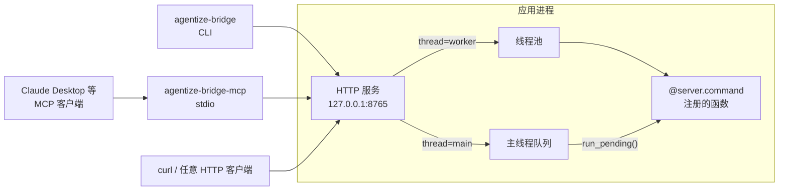

<div align="center">

# agentize-bridge

**让运行中的 Python 应用，成为 AI 代理可以调用的工具。**

一个装饰器注册命令，同时获得 HTTP、CLI、MCP 三个入口，并支持在宿主程序的主线程中执行命令。

[](docs/getting-started.md#安装)
[](LICENSE)

[**文档**](docs/README.md) · [快速开始](docs/getting-started.md) · [MCP 接入](docs/mcp.md) · [安全](docs/security.md)

</div>

---

桌面 GUI、DCC 软件等程序的状态只能在主线程中读写，无法直接接入 Web 框架，AI 代理因而无法调用它们。
使用 `agentize-bridge` 时，只需注册命令，参数校验、线程调度与对外暴露由框架负责。



## 快速开始

```bash
git clone https://github.com/ewoaoo/agentize-bridge.git
cd agentize-bridge
uv sync            # 或：pip install -e .
```

```python
import time

from agentize_bridge import AgentizeServer

server = AgentizeServer("My App")


@server.command()
def add(a: int, b: int = 2) -> int:
    """把两个数字相加。"""
    return a + b


if __name__ == "__main__":
    server.start_http(host="127.0.0.1", port=8765)
    try:
        while True:
            server.run_pending()   # 在主线程中执行 thread="main" 的命令
            time.sleep(0.01)
    except KeyboardInterrupt:
        server.close()
```

```bash
curl -X POST http://127.0.0.1:8765/command/add \
  -H 'Content-Type: application/json' -d '{"a": 2, "b": 3}'      # 5

agentize-bridge call add --args '{"a": 2, "b": 3}'                # 5
```

## 文档

[**完整文档 →**](docs/README.md) 位于仓库的 `docs/` 目录，下面是常用入口：

| | 说明 |
| --- | --- |
| [定义命令](docs/commands.md) | 参数、类型校验与 JSON Schema |
| [线程模型](docs/threading.md) | `worker` 与 `main`，接入主循环 |
| [实例方法](docs/instance-methods.md) | 暴露已有对象的方法 |
| [HTTP API](docs/http-api.md) · [CLI](docs/cli.md) · [MCP](docs/mcp.md) | 三种调用方式 |
| [安全与限制](docs/security.md) | 默认防护与已知缺口 |
| [开发](docs/development.md) | 测试、构建与代码结构 |

> [!WARNING]
> 当前**没有身份验证**，任何能访问端口的人都能调用所有命令。如果没有明确的可信网络，请保持默认的 `127.0.0.1`。详见[安全与限制](docs/security.md)。

## License

[MIT](LICENSE)
