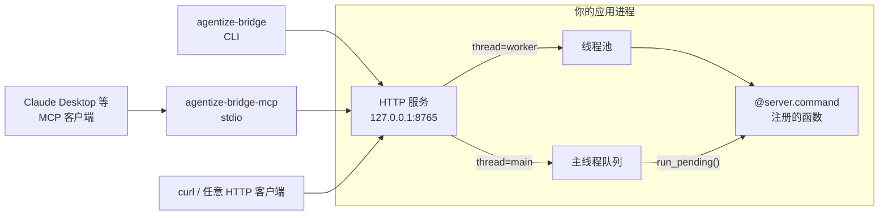

<div align="center">

# agentize-bridge

**让运行中的 Python 应用，成为 AI 代理可以调用的工具。**

一个装饰器注册命令，同时获得 HTTP、CLI、MCP 三个入口，并且尊重宿主程序的主线程。

[](#安装)
[](LICENSE)
[](#安全与限制)

</div>

---

桌面 GUI、DCC 软件这类程序的状态只能在主线程里读写，没法直接放进 Web 框架，Agent 也就调不到它们。
使用 `agentize-bridge`，只需要注册命令，参数校验、线程调度和对外暴露由它负责。



## 安装

要求 Python 3.11+，目前从源码使用：

```bash
git clone https://github.com/ewoaoo/agentize-bridge.git
cd agentize-bridge
uv sync            # 或：pip install -e .
```

## 快速开始

```python
import time

from agentize_bridge import AgentizeServer

server = AgentizeServer("My App")


@server.command()
def add(a: int, b: int = 2) -> int:
    """把两个数字相加。"""
    return a + b


@server.command(thread="main", timeout=5)
def get_state() -> dict:
    """读取只能在主线程访问的应用状态。"""
    return {"ready": True}


if __name__ == "__main__":
    server.start_http(host="127.0.0.1", port=8765)
    try:
        while True:
            server.run_pending()   # 在主线程里执行 thread="main" 的命令
            time.sleep(0.01)
    except KeyboardInterrupt:
        server.close()
```

运行 `python app.py` 后调用：

```bash
curl -X POST http://127.0.0.1:8765/command/add \
  -H 'Content-Type: application/json' -d '{"a": 2, "b": 3}'      # 5

agentize-bridge call add --args '{"a": 2, "b": 3}'                # 5
```

## 定义命令

`@server.command(...)` 把函数注册为命令：

| 参数 | 默认值 | 说明 |
| --- | --- | --- |
| `name` | 函数名 | 命令名，只允许 ASCII 字母、数字、`_`、`.`、`-` |
| `description` | 文档字符串首行 | 展示给调用方（包括 AI）的说明 |
| `thread` | `"worker"` | 在哪个线程执行，见[线程模型](#线程模型) |
| `timeout` | `30` | 等待命令完成的上限（秒）；可被请求的 `?timeout=` 覆盖 |

参数必须有类型注解（缺少会在注册时报错），它同时决定调用前的校验和对外公布的 JSON Schema：

```python
from typing import Annotated, Literal
from pydantic import Field

@server.command(description="按类型创建若干对象")
def spawn(
    kind: Literal["cube", "sphere"],
    count: Annotated[int, Field(ge=1, le=100, description="创建数量")] = 1,
) -> list[str]:
    ...
```

- 参数缺少、多余或类型不符时返回 `422`，命令不会执行；`"3"` 这类可转换的值会自动转成 `3`。
- 返回值需要能序列化为 JSON。
- 不支持 `*args`、`**kwargs`、仅位置参数；`async def` 只能用 `thread="worker"`。

### 实例方法

要暴露已有对象的方法，先把实例放进容器，再注册**未绑定**的方法：

```python
class Calculator:
    def __init__(self, base: int):
        self.base = base

    def add_base(self, value: int) -> int:
        """在基础值上累加。"""
        return self.base + value

server.container.register("Calculator", Calculator(base=100))   # 键必须是类名
server.command()(Calculator.add_base)                            # 不是 calculator.add_base

# POST /command/add_base {"value": 5}  ->  105
```

- 嵌套类的键取最内层的类名（`Outer.Inner` 用 `"Inner"`）。
- 每个类名只能对应一个实例，同名类会冲突；子类继承而未重写的方法，需要在子类里显式重写。
- 实例缺失要到调用时才暴露，表现为 `500`。
- `@staticmethod` 和 `@classmethod` 不需要实例，直接注册即可。

### 线程模型

| | `thread="worker"`（默认） | `thread="main"` |
| --- | --- | --- |
| 执行位置 | 内部线程池 | 调用 `run_pending()` 的线程 |
| 适合 | 不依赖主线程的逻辑 | 只能在主线程访问的状态：GUI、DCC 场景 |
| 宿主要做什么 | 无 | 在主循环里周期性调用 `run_pending()` |
| `async def` | 支持 | 不支持 |

- `run_pending(limit=None)` 执行排队的命令并返回处理个数；用 `limit` 控制每次占用主线程的时间，并始终在同一个线程里调用。
- 队列容量 64，满时返回 `503`；宿主不调用 `run_pending()` 时，`main` 命令会等到超时并返回 `504`。
- 超时只会取消尚未开始的命令，**已经在执行的命令不会被中止**。

## 调用命令

服务启动后，有三种方式调用命令。CLI 与 MCP 都是 HTTP 服务的客户端，共用两个选项：`--url`（默认 `http://127.0.0.1:8765`，或环境变量 `AGENTIZE_BRIDGE_URL`）和 `--timeout`（默认 30 秒）。

### HTTP API

| 方法 | 路径 | 说明 |
| --- | --- | --- |
| `GET` | `/health` | 健康检查 |
| `GET` | `/commands` | 列出命令、说明与参数 schema |
| `POST` | `/command/{name}` | 调用命令，请求体为 JSON 对象，可加 `?timeout=秒数` |

成功时直接返回命令的返回值，出错时返回 `{"detail": ...}`：

| 状态码 | 含义 |
| --- | --- |
| `400` / `403` | `Host` / `Origin` 不被允许 |
| `404` | 命令不存在 |
| `422` | 参数未通过校验 |
| `500` | 命令执行失败 |
| `503` | 主线程队列已满，或服务已关闭 |
| `504` | 等待超时 |

### CLI

```bash
agentize-bridge list
agentize-bridge call add --args '{"a": 2, "b": 3}'
```

### MCP

`agentize-bridge-mcp` 通过 stdio 运行，每个命令对应一个 MCP 工具。Claude Desktop 配置：

```json
{
  "mcpServers": {
    "my-app": {
      "command": "agentize-bridge-mcp",
      "args": ["--url", "http://127.0.0.1:8765"]
    }
  }
}
```

没有把命令装进 PATH 时，可改用 `"command": "uv"`，`"args": ["run", "--directory", "/path/to/agentize-bridge", "agentize-bridge-mcp", ...]`。

> [!NOTE]
> MCP 的工具列表在进程启动时读取一次，服务端增删命令后需要重启 MCP 进程。

## 安全与限制

> [!WARNING]
> 当前**没有身份验证**，任何能访问端口的人都能调用所有命令。请保持默认的 `127.0.0.1`，不要暴露到不可信网络。

- `start_http` 会校验 `Host` 与 `Origin`，挡住浏览器网页发起的跨站请求和 DNS rebinding；自行用 uvicorn 挂载 `fastapi_app` 时不会启用。
- 命令抛出的异常文本会原样出现在 `500` 响应里，不要在其中放敏感内容。
- 没有 TLS、限流、流式输出和长任务 ID；返回值没有 schema。

## 开发

```bash
uv sync                                # 安装依赖（含测试与构建工具）
uv run pytest                          # 运行测试
uv run pytest --cov=agentize_bridge    # 同时统计覆盖率
uv run python examples/app.py          # 启动示例应用
uv build                               # 构建发行包
```

源码在 `src/agentize_bridge/`，`tests/` 与之一一对应：

| 模块 | 职责 |
| --- | --- |
| `server.py` | 对外入口 `AgentizeServer`，HTTP 服务与请求校验 |
| `command.py` | 命令的定义与注册 |
| `schema.py` | 从类型注解生成参数模型与 JSON Schema |
| `executor.py` | 执行命令：线程、超时、实例绑定 |
| `queues.py` | 主线程任务队列 |
| `container.py`、`util.py` | 实例容器，以及实例方法的识别 |
| `adapters/` | CLI、MCP 服务与 HTTP 客户端 |

## License

[MIT](LICENSE)
