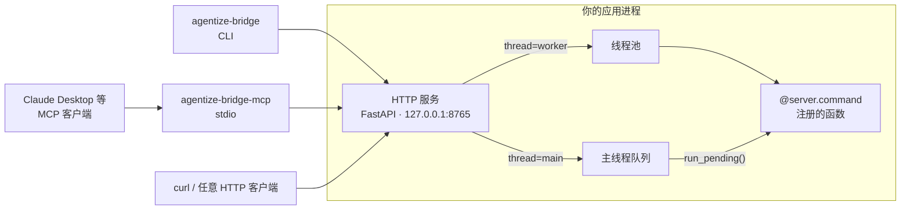

<div align="center">

# agentize-bridge

**让运行中的 Python 应用，成为 AI 代理可以调用的工具。**

一个装饰器注册命令，同时获得 HTTP、CLI 与 MCP 三个入口，
并且尊重宿主程序的主线程。

[](#安装)
[](LICENSE)
[](#限制)

[快速开始](#快速开始) · [定义命令](#定义命令) · [线程模型](#线程模型) · [HTTP API](#http-api) · [CLI](#cli) · [MCP](#mcp) · [安全](#安全)

</div>

---

桌面 GUI、DCC 软件……要让 Agent 调用这类程序，需要一个对外的接口。这类程序的状态只能在主线程里安全读写，没法直接塞进一个 Web 框架。
`agentize-bridge` 把「注册命令、跨线程调度、对外暴露」这条链路收敛成一个很小的库：

- **一份定义，三个入口。** 命令只写一次，HTTP、CLI、MCP 共用同一份定义。
- **主线程友好。** 命令可以在后台线程池执行，也可以排队等宿主在自己的主循环里取走。
- **参数即契约。** 命令参数由类型注解驱动，调用前先校验；对外发布的是标准 JSON Schema。

## 工作方式



CLI 与 MCP 适配器都只是这条 HTTP 服务的客户端，所以系统里始终只有一套命令定义，和一个真正执行命令的地方。

## 安装

要求 Python 3.11 及以上。本项目目前不通过 PyPI 分发，从源码使用：

```bash
git clone https://github.com/ewoaoo/agentize-bridge.git
cd agentize-bridge
uv sync            # 或：pip install -e .
```

## 快速开始

新建 `app.py`：

```python
import time

from agentize_bridge import AgentizeServer

server = AgentizeServer("My App")


@server.command()
def add(a: int, b: int = 2) -> int:
    """把两个数字相加。"""
    return a + b


@server.command(thread="main", timeout=5)
def get_state() -> dict:
    """读取只能在主线程访问的应用状态。"""
    return {"ready": True}


if __name__ == "__main__":
    server.start_http(host="127.0.0.1", port=8765)
    try:
        while True:
            server.run_pending()   # 在拥有应用状态的线程里取走 main 命令
            time.sleep(0.01)
    except KeyboardInterrupt:
        server.close()
```

运行，然后用任意一种方式调用：

```bash
python app.py
```

```bash
# HTTP
curl -X POST http://127.0.0.1:8765/command/add \
  -H 'Content-Type: application/json' \
  -d '{"a": 2, "b": 3}'
# 5

# CLI
agentize-bridge call add --args '{"a": 2, "b": 3}'
```

完整示例见 [`examples/app.py`](examples/app.py)。

## 定义命令

`@server.command(...)` 把一个普通函数注册为命令：

| 参数 | 默认值 | 说明 |
| --- | --- | --- |
| `name` | 函数名 | 命令名，只允许 ASCII 字母、数字、`_`、`.`、`-` |
| `description` | 文档字符串首行，没有则用命令名 | 展示给调用方（包括 AI）的说明 |
| `thread` | `"worker"` | 执行位置，见[线程模型](#线程模型) |
| `timeout` | `None` | 默认等待秒数，可被单次请求覆盖；`None` 表示一直等待 |

**参数必须有类型注解。** 注解既决定对外公布的 JSON Schema，也决定调用前的校验：

```python
from typing import Annotated, Literal

from pydantic import Field


@server.command(description="按类型创建若干对象")
def spawn(
    kind: Literal["cube", "sphere"],
    count: Annotated[int, Field(ge=1, le=100, description="创建数量")] = 1,
) -> list[str]:
    ...
```

- Pydantic 2 能够校验、并能生成 JSON Schema 的类型都可以使用；`Annotated[..., Field(...)]` 用来补充说明与约束。
- 缺少注解、`*args` / `**kwargs`、仅位置参数会在**注册时**报错，而不是等到调用时。需要任意类型请显式标注 `Any`。
- 调用前参数会被校验并按 Pydantic 的默认规则转换（例如 `"3"` 会转成 `3`）；缺少、多余或类型不符的参数返回 `422`，命令不会被执行。
- 返回值需要能被序列化为 JSON。
- `async def` 命令只能使用 `thread="worker"`。

## 线程模型

这是使用本项目时最需要理解的部分。

| | `thread="worker"`（默认） | `thread="main"` |
| --- | --- | --- |
| 在哪里执行 | 内部线程池 | 宿主调用 `run_pending()` 的那个线程 |
| 适合 | 不依赖宿主主线程的逻辑 | 只能在主线程读写的状态：GUI 控件、DCC 场景 |
| 宿主要做什么 | 什么都不用做 | 在主循环里周期性调用 `run_pending()` |
| `async def` | 支持 | 不支持 |
| 排队 | 无 | 队列容量 64，满时返回 `503` |

```python
while True:
    server.run_pending()      # 取走并执行当前排队的命令，返回处理的个数
    time.sleep(0.01)
```

- `run_pending(limit=None)` 一次最多处理调用时已在队列里的命令；limit 用来限制单次调用处理的命令数，从而控制每次占用主线程的时间；在宿主自己的定时器或事件循环里调用它。
- 宿主不调用 `run_pending()` 时，`main` 命令会一直等待，直到调用方超时。
- 超时的等待时间取单次请求的 `?timeout=`，其次是命令自己的 `timeout`，都没有则一直等。超时后尚未开始的命令会被取消，**已经在执行的命令不会被中止**。

## HTTP API

| 方法 | 路径 | 说明 |
| --- | --- | --- |
| `GET` | `/health` | 健康检查，返回 `{"status": "ok"}` |
| `GET` | `/commands` | 列出所有命令及其输入 schema |
| `POST` | `/command/{name}` | 调用命令，请求体是 JSON 对象；可加 `?timeout=秒数` |

`GET /commands` 的返回示例：

```json
[
  {
    "name": "add",
    "description": "把两个数字相加。",
    "thread": "worker",
    "input_schema": {
      "type": "object",
      "properties": {
        "a": { "type": "integer" },
        "b": { "type": "integer", "default": 2 }
      },
      "required": ["a"],
      "additionalProperties": false
    }
  }
]
```

`POST /command/{name}` 成功时直接返回命令的返回值。出错时使用 FastAPI 的 `{"detail": ...}` 结构：

| 状态码 | 含义 |
| --- | --- |
| `404` | 命令不存在 |
| `422` | 参数未通过校验 |
| `500` | 命令执行失败 |
| `503` | 主线程命令队列已满 |
| `504` | 等待超时 |

## CLI

```bash
agentize-bridge list
agentize-bridge call add --args '{"a": 2, "b": 3}'
```

| 选项 | 默认值 | 说明 |
| --- | --- | --- |
| `--url` | `http://127.0.0.1:8765`，或环境变量 `AGENTIZE_BRIDGE_URL` | 服务地址 |
| `--timeout` | `30` | 请求超时秒数，同时作为本次调用的服务端等待时间 |

选项写在子命令之前：`agentize-bridge --url http://127.0.0.1:9000 list`。成功时输出 JSON 并以 `0` 退出，失败时错误写入 stderr 并以 `1` 退出。

## MCP

`agentize-bridge-mcp` 通过 stdio 运行，并连接到已经启动的 HTTP 服务。每个命令对应一个 MCP 工具，名称、描述和参数 schema 与命令一致，调用结果以 JSON 文本返回。

Claude Desktop 配置示例：

```json
{
  "mcpServers": {
    "my-app": {
      "command": "agentize-bridge-mcp",
      "args": ["--url", "http://127.0.0.1:8765"]
    }
  }
}
```

从源码使用、没有把命令装进 PATH 时，可以让 `uv` 代为运行：

```json
{
  "mcpServers": {
    "my-app": {
      "command": "uv",
      "args": [
        "run", "--directory", "/path/to/agentize-bridge",
        "agentize-bridge-mcp", "--url", "http://127.0.0.1:8765"
      ]
    }
  }
}
```

选项与 CLI 相同：`--url`（或 `AGENTIZE_BRIDGE_URL`）、`--timeout`。

> [!NOTE]
> 工具列表在 MCP 进程启动时读取一次。服务端新增或修改命令后，需要重启 MCP 进程。

## Python API

| 成员 | 说明 |
| --- | --- |
| `AgentizeServer(name="Agentize Bridge")` | 创建服务；支持 `with` 语句，退出时自动 `close()` |
| `@server.command(name, description, thread, timeout)` | 注册命令 |
| `server.start_http(host="127.0.0.1", port=8765)` | 在后台线程启动 HTTP 服务，等待就绪后返回 |
| `server.run_pending(limit=None)` | 在当前线程执行排队中的 `main` 命令，返回处理个数 |
| `server.close(wait=True)` | 关闭服务；队列中尚未执行的请求会立即失败，`wait=True` 会等待正在执行的 worker 命令结束 |

## 安全

> [!WARNING]
> 当前版本**没有任何身份验证**。任何能访问这个端口的人，都可以调用你注册的所有命令。

服务默认只绑定 `127.0.0.1`，请保持这个默认值，不要把端口暴露到不可信网络。

## 限制

- 没有鉴权、TLS、限流。
- 超时不会中止已经开始执行的命令。
- MCP 工具列表是启动时的快照。
- 命令的返回值没有声明 schema，以普通 JSON 返回。
- 没有流式输出、进度通知或长任务 ID。

## 项目结构

```text
src/agentize_bridge/
├── server.py        AgentizeServer：命令注册、HTTP 路由与调度
├── command.py       Command 定义与注册时的检查
├── schema.py        由函数签名生成参数模型与 JSON Schema
├── executor.py      调用前校验参数并执行命令
├── queues.py        主线程命令队列
└── adapters/
    ├── http_client.py   适配器共用的 HTTP 客户端
    ├── cli.py           agentize-bridge
    └── mcp_server.py    agentize-bridge-mcp
```

## 开发

```bash
uv sync --group test
uv run pytest
```

构建 wheel：

```bash
uv build           # 产物位于 dist/
```

## License

[MIT](LICENSE)
