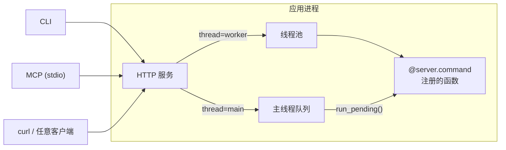

# agentize-bridge 文档

**让运行中的 Python 应用，成为 AI 代理可以调用的工具。**

[快速开始](getting-started.md) · [定义命令](commands.md) · [线程模型](threading.md) · [HTTP API](http-api.md) · [MCP](mcp.md)

---

## 它是怎么工作的

命令只需在应用进程中定义一次。HTTP 是唯一入口，CLI 与 MCP 均为其客户端。

## 目录

### 上手

| | 说明 |
| --- | --- |
| [**快速开始**](getting-started.md) | 安装、最小示例、服务的启动与关闭 |

### 编写命令

| | 说明 |
| --- | --- |
| [**定义命令**](commands.md) | `@server.command` 的参数、类型校验与 JSON Schema |
| [**线程模型**](threading.md) | `worker` 与 `main` 的区别，主循环的接入方式 |
| [**实例方法**](instance-methods.md) | 通过容器暴露已有对象的方法 |

### 调用命令

| | 说明 |
| --- | --- |
| [**HTTP API**](http-api.md) | 接口、请求格式与状态码 |
| [**CLI**](cli.md) | 在终端中列出并调用命令 |
| [**MCP**](mcp.md) | 接入 Claude Desktop 等 MCP 客户端 |

### 参考

| | 说明 |
| --- | --- |
| [**安全与限制**](security.md) | 默认防护、已知缺口 |
| [**开发**](development.md) | 测试、构建与代码结构 |

## 我想……

| 场景 | 去哪里 |
| --- | --- |
| 让 AI 调用我 GUI 程序里的函数 | [线程模型](threading.md) |
| 给命令加上取值范围、枚举 | [定义命令](commands.md#参数与校验) |
| 暴露一个已有对象的方法 | [实例方法](instance-methods.md) |
| 在 Claude Desktop 里用上我的命令 | [MCP](mcp.md) |
| 搞清楚某个报错的含义 | [HTTP API · 状态码](http-api.md#状态码) |
