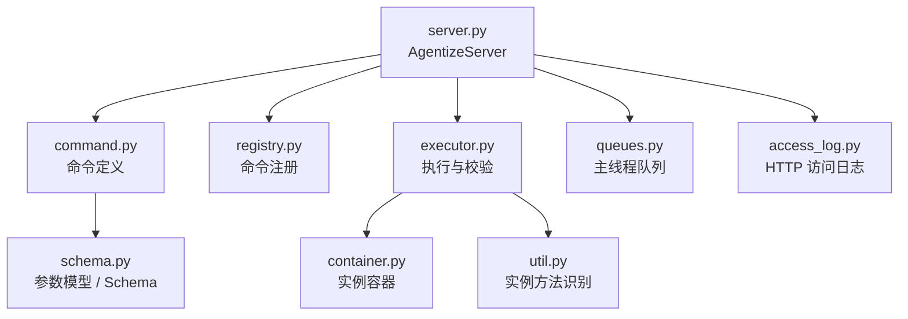

<sub>[文档](README.md) / 开发</sub>

# 开发

> 测试、构建与代码结构。

## 常用命令

```bash
uv sync                                # 安装依赖（含测试与构建工具）
uv run pytest                          # 运行测试
uv run pytest --cov=agentize_bridge    # 同时统计覆盖率
uv run pytest tests/test_access_log.py # 单独运行访问日志测试，无需绑定端口
uv run python examples/app.py          # 启动示例应用
uv build                               # 构建发行包
```

## 代码结构

源码位于 `src/agentize_bridge/`，测试位于 `tests/`。



| 模块 | 职责 |
| --- | --- |
| `server.py` | 对外入口 `AgentizeServer`，HTTP 服务与请求校验 |
| `access_log.py` | 包装 HTTP 的 ASGI 入口并输出访问日志，路由和请求处理由原 FastAPI 应用负责 |
| `command.py` | 命令的数据模型与创建 |
| `schema.py` | 从类型注解生成参数模型与 JSON Schema |
| `registry.py`| 命令的注册  |
| `executor.py` | 执行命令：线程、超时、实例绑定 |
| `queues.py` | 主线程任务队列 |
| `container.py` `util.py` | 实例容器，以及实例方法的识别 |
| `adapters/` | CLI、MCP 服务与 HTTP 客户端 |

## 设计要点

- **一份注解，两个用途。** 参数模型既生成对外的 JSON Schema，也负责调用前的校验，两者不会不一致。
- **适配器保持轻量。** CLI 与 MCP 仅做协议转换，校验与调度只在服务端完成一次。

---

<div align="center">

[← 安全与限制](security.md) · [回到目录](README.md)

</div>
