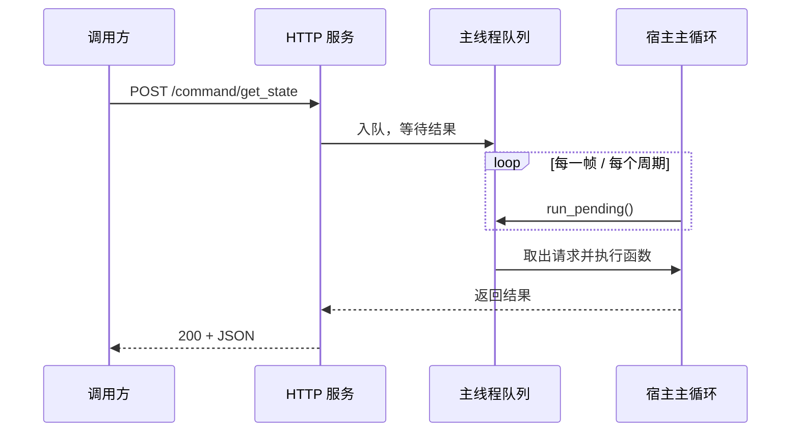

<sub>[文档](README.md) / 线程模型</sub>

# 线程模型

> GUI、DCC 软件的状态只能在主线程中读写，`thread` 参数决定命令的执行线程。

## 两种模式

| | `thread="worker"`（默认） | `thread="main"` |
| --- | --- | --- |
| 执行位置 | 内部线程池 | 调用 `run_pending()` 的线程 |
| 适合 | 不依赖主线程的逻辑 | 只能在主线程访问的状态 |
| 宿主需执行 | 无 | 在主循环中周期性调用 `run_pending()` |
| `async def` | 支持 | 不支持 |

## `main` 命令的一次调用



HTTP 请求会保持等待，直至主线程取出并执行该命令，或等待超时。

## 接入主循环

```python
while True:
    server.run_pending()
    time.sleep(0.01)
```

在已有的事件循环中，可将其绑定到定时器，例如 Qt 的 `QTimer`：

```python
timer = QTimer()
timer.timeout.connect(lambda: server.run_pending(limit=5))
timer.start(10)
```

`run_pending(limit=None)` 执行排队的命令并返回处理个数。

- 通过 `limit` 限制单次占用主线程的时间，避免命令堆积时界面响应变慢。
- 应始终在**同一线程**中调用，否则 `main` 模式将失去意义。
- 服务关闭后调用将返回 `0`。

## 队列、超时与取消

| 情况 | 结果 |
| --- | --- |
| 队列已满（容量 64） | `503` |
| 宿主未调用 `run_pending()` | 等待至超时，返回 `504` |
| 超时时命令尚未开始 | 命令被取消，不会再执行 |
| 超时时命令已经在执行 | **不会被中止**，将继续执行至结束，结果被丢弃 |

> [!WARNING]
> 超时仅能取消排队中的命令。长时间运行的命令，即使调用方已收到 `504`，仍会继续占用线程。耗时操作请自行拆分，或在函数内部实现中断检查。

---

<div align="center">

[← 定义命令](commands.md) · [实例方法 →](instance-methods.md)

</div>
